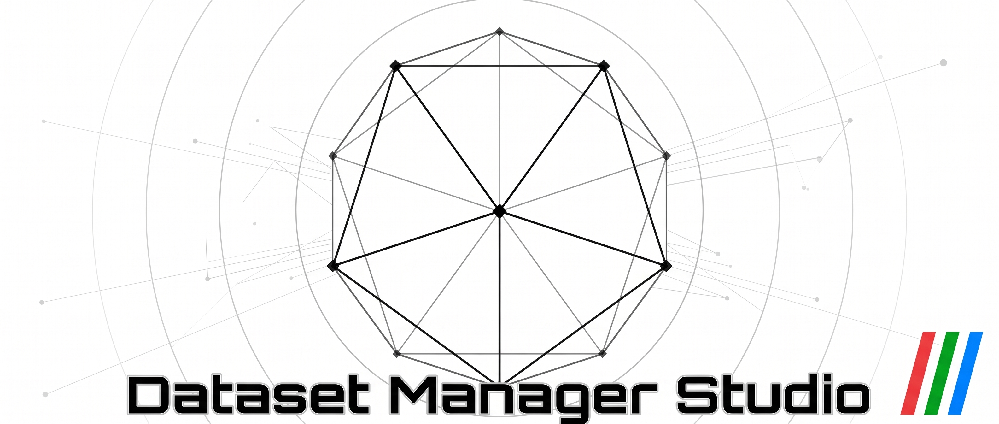

# Osmium Workshop

## [Try Live Demo](https://valteil.github.io/osmium-workshop/)

A feature-heavy, ComfyUI-compatible dataset manager built around **Anima** (Circlestone Labs'
diffusion model) and the booru-tag models in its family. Other models work too, but the tag
conventions, categories and generation workflow all follow Anima. Curate a folder of images, tag
them, grow the dataset with generated images, and train a LoRA on it, all in one portable app.

Built with Electron + TypeScript, and with a shitload of Claude and Opencode Go.

Disclaimer: as obviously stated, nearly all of this is AI-built. If for whatever reason that
somehow makes you grossed out when the whole point of a dataset curator is to train genAI, then
I don't know go eat a rock or something.

**Docs:** the in-app **❓ Help** covers every tab · [User guide](USER_GUIDE.md) ·
[Patch notes](PATCH_NOTES.md)

---

## Download

Everything is on the [releases page](https://github.com/Valteil/osmium-workshop/releases/latest).

| File | What it is |
|---|---|
| `Osmium.Workshop-<version>-win.zip` | The dataset manager (Windows, portable) |
| `Anima-TrainFlow-Osmium-<version>.zip` | The trainer for the **Trainflow** tab (optional) |
| `Comfy.Bridge-<version>-win.zip` | Comfy Bridge: a simple generation UI for ComfyUI (Windows) |
| `ComfyBridge-<version>-android.apk` | Comfy Bridge for Android |
| `ComfyUI-DataSetManagerNodes.zip` | The ComfyUI node pack SynthDat and Comfy Bridge need |

The Osmium Android app is on its own `-android` pre-release.

## Install

**Osmium Workshop.** Unzip anywhere and run `Osmium Workshop.exe`. Nothing is installed; your
settings live in the `data/` folder beside it. Open a dataset with **File → Open dataset folder**
(images plus matching `.txt` captions).

**Trainflow (training LoRAs, NVIDIA GPU).**
1. Unzip `Anima-TrainFlow-Osmium-<version>.zip` somewhere with about 8 GB free.
2. Run `Install_Requirements.bat` in it once. It downloads PyTorch and the trainer's packages
   (about 5 GB) at the exact versions Trainflow is tested with.
3. In Osmium's **Trainflow** tab, choose that folder, then pick your Anima (or Janima) DiT, Qwen3
   text encoder and VAE.

This is [Anima-TrainFlow](https://github.com/ThetaCursed/Anima-TrainFlow) by ThetaCursed with a newer
sd-scripts (v0.12.0) and the patches Trainflow needs; it's the version Trainflow is tested with.

**ComfyUI features (SynthDat, Comfy Bridge).** Unzip `ComfyUI-DataSetManagerNodes.zip` into your
ComfyUI's `custom_nodes` folder. Both can use a running ComfyUI, or (on Windows) start your install
themselves as **Osmium Comfy**, without a server. WD14 tagging runs on-device and doesn't need ComfyUI.

**Comfy Bridge.** Unzip and run, or sideload the APK on your phone. The phone can use a ComfyUI server
directly, or go through the desktop Bridge (**Let the phone app use it**). For extra samplers
(`res_2m`, `res_2s` and friends), install the separate [RES4LYF](https://github.com/ClownsharkBatwing/RES4LYF)
node pack in your ComfyUI (for example through ComfyUI Manager); Bridge lists them once it's there.

**Updating.** There's no auto-updater: unzip the new version and move your old `data/` folder into
it. Android updates install over the old APK.

---

## Major features

- **Gallery & tagging.** Grid, Single and Sequential views; tags as editable chips, sorted into
  categories; batch add/remove/rename, find & replace, Master Tags across the dataset, and
  Merge/Void with standing rules that keep catching stray tags.
- **WD14 autotagger.** Runs on your PC (no ComfyUI needed), with a review window to accept or reject
  each tag before it lands.
- **Curate tab.** Go through a folder of new images first: grid or one at a time, duplicate finder,
  low-resolution flags, sort them into artstyle folders or junk, then add the keepers to a dataset.
- **Image editing.** Crop, rotate, Isolate and Isolate (Split) for cutting up sheets and panels; every
  edit can be undone.
- **Bucket Images.** Crops every image to its training bucket around the subject, keeping the
  originals. Sizes are per dataset, with presets for 512/1024-style training.
- **Trainflow tab.** Trains a LoRA, LoKr or LoHa for Anima/Janima on the loaded dataset in the
  background. Continue a run, send a checkpoint to your LoRA folder, and every retrain gets its own
  folder.
- **SynthDat Overseer.** Generates new dataset images from your existing ones through ComfyUI, for you
  to accept or reject.
- **Edit Log.** Every change is logged with undo/redo, per image or for the whole edit.
- **Comfy Bridge.** A no-node-graph generation UI for the same workflow, on Windows and Android: LoRA
  stack, 2-pass, USDU upscaling, a gallery, image/LoRA metadata, and a phone link to your PC.
- **Themes.** 26 full themes (5 free, the rest bought with Edibits you earn from achievements), Theme
  Studio for your own, and night mode.

The Android version of Osmium has the same interface in a touch layout; Bucket Images and Trainflow
stay desktop-only.

---

## License

MIT, see [LICENSE](LICENSE). Third-party code, fonts and models are listed in
[THIRD_PARTY_NOTICES.md](THIRD_PARTY_NOTICES.md).
